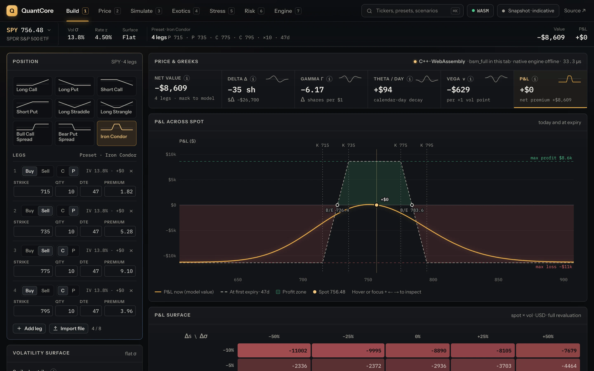
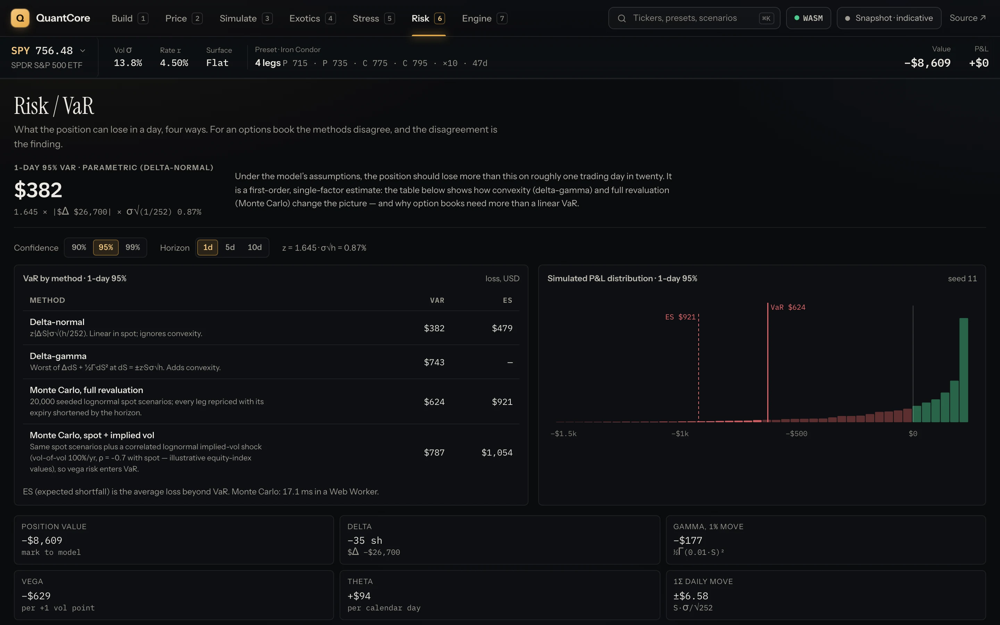
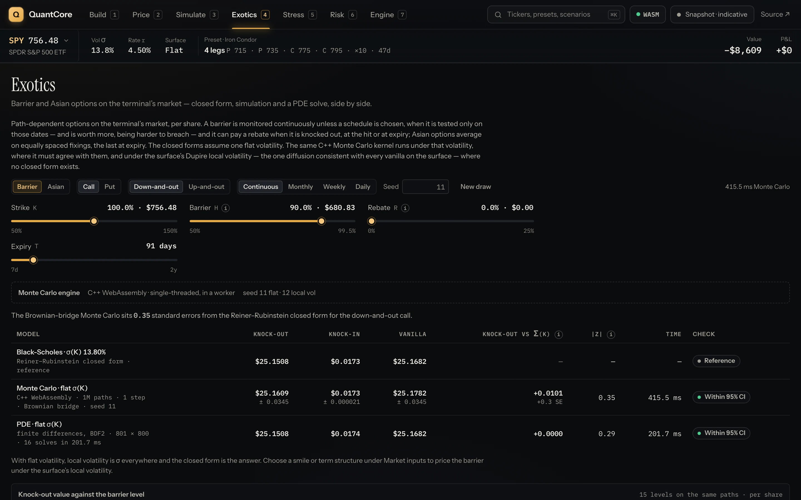
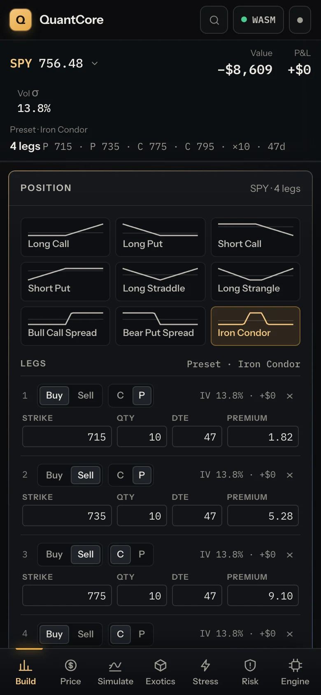

<div align="center">

# QuantCore

### An options pricing and risk terminal, backed by a C++17 engine that also runs inside your browser.

*Build a strategy, price it three ways, simulate it, stress it and measure its risk. Nothing to install.*

<br/>

[](https://quantcore-gk.netlify.app)
[](https://gaurangkhurana.ca)
[](#-try-it)

<br/>


[](https://github.com/gkhurana21/quantcore/actions/workflows/ci.yml)


[Features](#-what-it-does) • [Try it](#-try-it) • [Under the hood](#-under-the-hood) • [Limitations](#limitations) • [Technical reference](docs/TECHNICAL.md)

</div>

---



<table>
<tr>
<td width="38%" valign="top"></td>
<td width="38%" valign="top"></td>
<td width="24%" valign="top"></td>
</tr>
<tr>
<td align="center"><sub><b>Risk.</b> Four VaR methods on one position.</sub></td>
<td align="center"><sub><b>Exotics.</b> Barrier and Asian options, checked three ways.</sub></td>
<td align="center"><sub><b>Phone.</b> Same terminal, stacked.</sub></td>
</tr>
</table>

## The problem

Most options tools show you one number from one model and ask you to trust it. A Black-Scholes price says nothing
about early exercise, a skewed volatility surface, a barrier, or how much a crash would cost you. Tools that do
check those things are usually spreadsheets, or heavy software that needs a server and a licence.

## The fix

**QuantCore prices the same portfolio several ways and shows you where they disagree.** It does this in a terminal
you open in a browser. The pricing code is C++17, compiled to WebAssembly, so the public demo needs no server. Run
the native engine on your own Mac and the same terminal uses it, including a GPU Monte Carlo on Apple Metal.

<table>
<tr>
<td align="center" width="25%"><h3>69x</h3><sub>Monte Carlo on Apple Metal vs vectorized NumPy, 10M paths (M3 MacBook Air)</sub></td>
<td align="center" width="25%"><h3>4.6 ms</h3><sub>p99 WebSocket latency with 5 clients (3.1 ms with one), on localhost</sub></td>
<td align="center" width="25%"><h3>4.5%</h3><sub>VaR breach rate over 851 days, against 5% expected</sub></td>
<td align="center" width="25%"><h3>88 KB</h3><sub>the whole C++ pricing core as a WebAssembly module</sub></td>
</tr>
</table>

## ✨ What it does

Seven workspaces, one position that all of them work on. Press `1` to `7`, or `[` and `]`, to move between them.

<table>
<tr>
<td width="50%"><b>1 Build.</b> Pick a ticker, a preset or up to eight custom legs, and a volatility surface with skew and term structure. Price, delta, gamma, theta and vega tiles, exact max profit, max loss and break-evens, a payoff chart, and a spot-by-vol P&amp;L surface. Any US ticker loads live when the optional data proxy runs.</td>
<td width="50%"><b>2 Price.</b> The Pricing Models Lab. One portfolio priced by Black-Scholes, a binomial lattice and Monte Carlo. It shows the gaps, the error bars, and what early exercise adds to American options.</td>
</tr>
<tr>
<td><b>3 Simulate.</b> Animated risk-neutral paths, a terminal distribution against its analytic density, and simulated against analytic probability of finishing in the money.</td>
<td><b>4 Exotics.</b> Barrier options (continuous or monitored on a schedule, with rebates) and Asian options, each checked against a second method.</td>
</tr>
<tr>
<td><b>5 Stress.</b> Credit crisis, crash, volatility spike, rate shock or your own shock, with P&amp;L by leg and every scenario side by side.</td>
<td><b>6 Risk.</b> Parametric, delta-gamma and Monte Carlo VaR, with expected shortfall at 90, 95 and 99% over 1, 5 and 10 days.</td>
</tr>
<tr>
<td><b>7 Engine.</b> See which engine produced each number. In the browser it is the WebAssembly build. Run it locally and you get live latency, engine-versus-browser agreement and 100k to 10M-path Monte Carlo on Metal.</td>
<td><b>Import.</b> Drop in a CSV, XLSX or XLS (key <code>I</code>). It is parsed in your browser with tolerant column names, a row-by-row preview and clear errors.</td>
</tr>
</table>

### Keyboard

Built for speed: nothing needs the mouse. The keys are single letters, they never fire while you type in a field, and the
list below is the same table the app reads, so it cannot drift. `?` opens it in the terminal.

| Key | Does | Key | Does |
|---|---|---|---|
| `1`-`7` | switch workspace | `M` | market controls: spot, vol, rate, dividend |
| `[` `]` | previous, next workspace | `V` | volatility surface |
| `⌘K` or `/` | command palette | `I` | import a portfolio file |
| `P` | palette, on the presets | `R` | reset the market (undo for 5 s) |
| `?` | all shortcuts | `N` | new Monte Carlo draw |
| `Esc` | close any sheet or dialog | `T` | show or hide the intro band |

A switch in the `?` sheet turns the single-key shortcuts off (`⌘K` and `Esc` stay), for anyone who uses voice control or
a screen reader that collides with them.

Every tile is labelled with the engine that produced it. The full description of each workspace is in the
[technical reference](docs/TECHNICAL.md#features-in-full).

## ⚡ Try it

**In the browser:** open <https://quantcore-gk.netlify.app>. Nothing to install.

**On your Mac with the native engine** (Apple Silicon, CMake 3.21+, a C++17 compiler, Python 3.9+, Node 18.17+):

```bash
pip install pybind11 numpy scipy yfinance fastapi uvicorn websockets
cmake -B build -DCMAKE_BUILD_TYPE=Release -DPython3_EXECUTABLE=$(which python3)
cmake --build build --parallel
./build/tests/phase1_validation        # the C++ acceptance gate
python server/ws_server.py 8765        # start the engine
cd dashboard && npm install && npm run dev   # http://localhost:3000, badge turns "Connected"
```

The terminal also works without the engine. It then computes in the browser and the badge reads *Offline*. Live
quotes, the full test commands and deployment are in the [technical reference](docs/TECHNICAL.md#quickstart).

```bash
cd dashboard
npm run test:unit             # pricing, risk and import libraries, no browser
npm run test:e2e              # the browser suite; the native-engine specs skip, with the reason printed
npm run test:e2e:engine       # the same with the engine started and required (PYTHON=... picks the interpreter)
```

CI runs the lint, types, unit tests, the static export and the browser suite on every push and pull request, and builds
the C++ core on Linux with its acceptance gate and the WebSocket protocol check.

## 🔧 Under the hood

```
┌──────────────── Browser (Next.js 15, static export) ────────────────┐
│  Terminal UI · TypeScript models (BSM, CRR, Monte Carlo, VaR, SSVI) │
│  Web Worker for heavy work · C++ core as WebAssembly                │
└──────────────────────────────┬──────────────────────────────────────┘
                               │ WebSocket JSON (localhost only)
                    ┌──────────┴──────────┐
                    │  FastAPI + uvicorn  │
                    └──────────┬──────────┘
                               │ pybind11 (GIL released around C++ compute)
      ┌────────────────────────┴────────────────────────┐
      │              C++17 pricing core                 │
      ├────────────────────────┬────────────────────────┤
      │  CPU: Accelerate SIMD  │  GPU: Apple Metal,     │
      │  + multithreaded MC    │  Philox 4x32-10 PRNG   │
      └────────────────────────┴────────────────────────┘
```

* **The hosted demo has no server.** The C++ core is compiled to a standalone WebAssembly module. It prices the
  Greeks tiles and runs the Monte Carlo and finite-difference solves in a Web Worker. Charts, stress and VaR use
  TypeScript versions of the same models, which the unit tests hold to 1e-12 of the C++ results.
* **The WebAssembly build is reproducible.** A manifest records the compiler version, flags and a SHA-256 of the
  module and every source. The unit tests fail if a source changes without a rebuild, and a CI job rebuilds the module
  with the pinned Emscripten and requires a byte-identical result.
* **Models:** Black-Scholes-Merton with analytic Greeks, an arbitrage-free SSVI volatility surface, Dupire local
  volatility, a Cox-Ross-Rubinstein lattice, a local-volatility finite-difference solver, and Longstaff-Schwartz
  Monte Carlo with an Andersen-Broadie upper bound for American options.
* **Each model is checked against another.** The closed forms, the PDE solver and the simulation have to agree
  before a number is trusted, and the C++ acceptance gate checks that.
* **The GPU kernel** uses the Philox counter-based generator so every GPU thread has an independent stream. It
  computes in float32 and reduces in float64.

Every model, the WebSocket protocol, the benchmark method and the project layout are in the
[technical reference](docs/TECHNICAL.md).

## Limitations

* This is a research and teaching tool, not a trading or regulatory risk system.
* Prices are indicative snapshots or prices you enter, unless live data is on. Live data is Alpaca's free feed.
* American early exercise is priced only in the Pricing Models Lab. The Greeks, stress and VaR treat options as
  European.
* The Metal GPU kernel prices one contract per run, and it needs a Mac. Portfolios and exotics run on the CPU or in
  WebAssembly.
* Stress scenarios are illustrative shocks, not historical replays. VaR is a single-underlying model.

The full list is in the [technical reference](docs/TECHNICAL.md#limitations).

## License

MIT. See [LICENSE](LICENSE).
